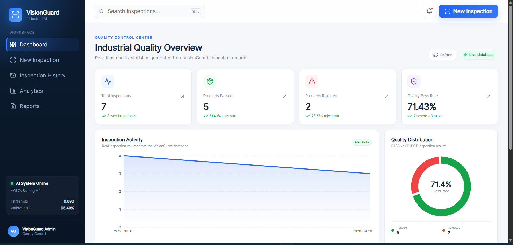
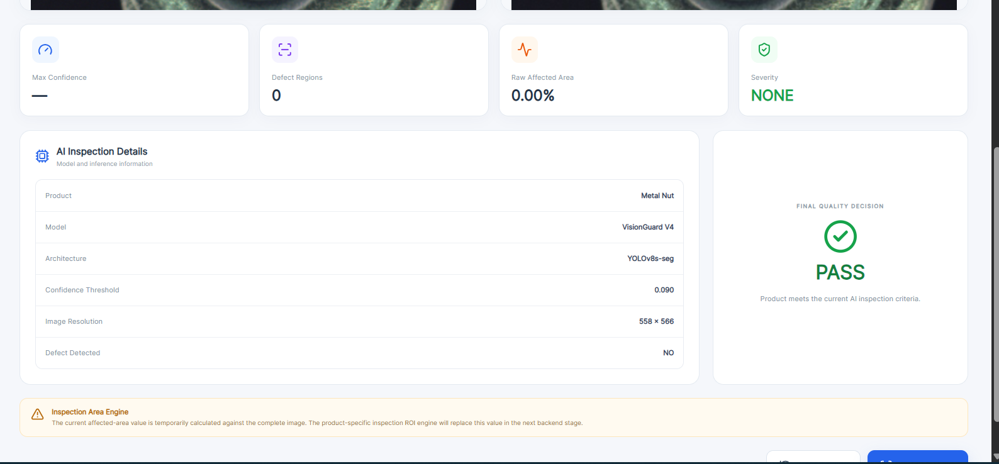
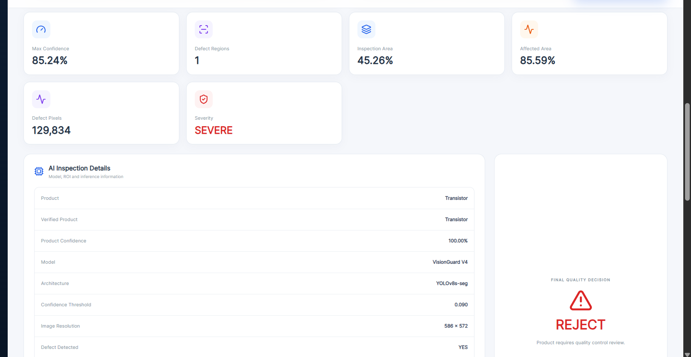
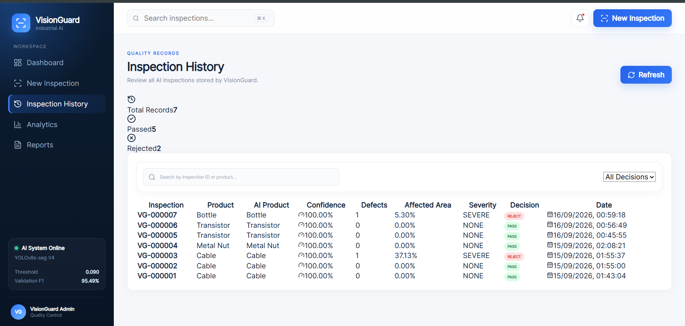
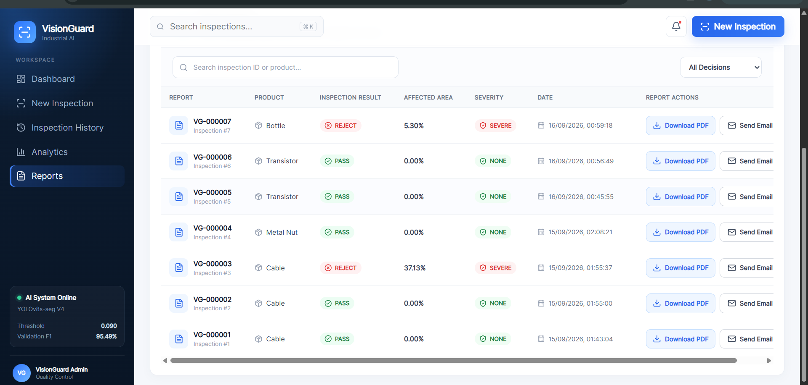
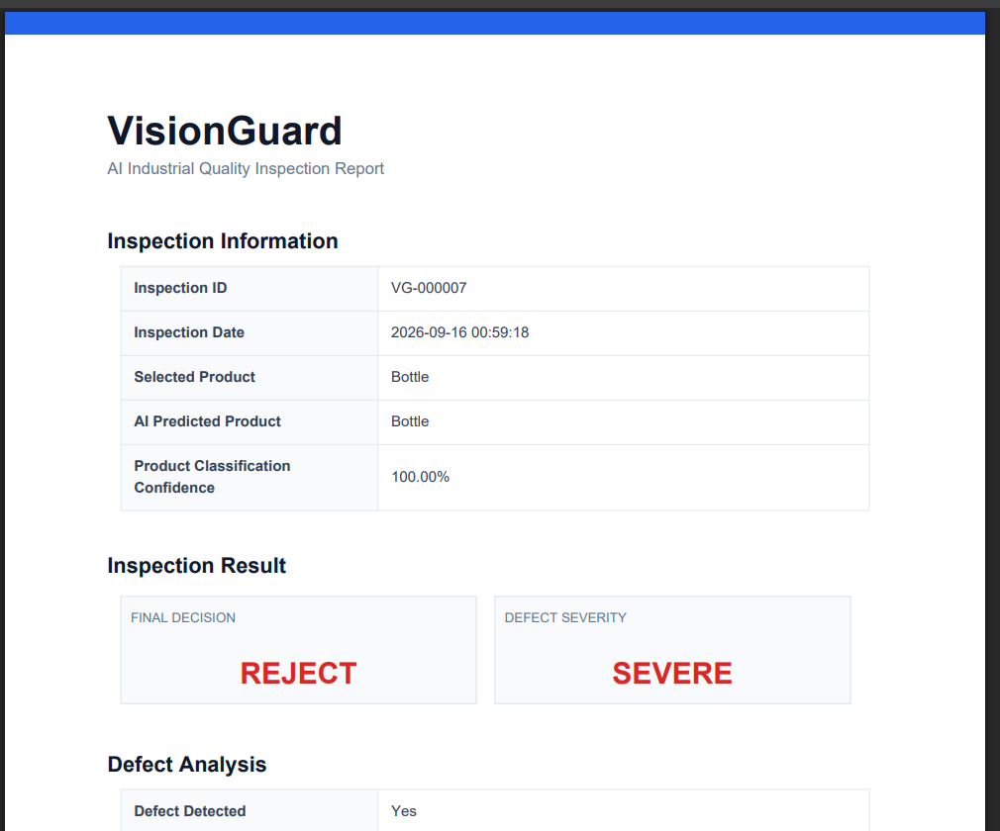
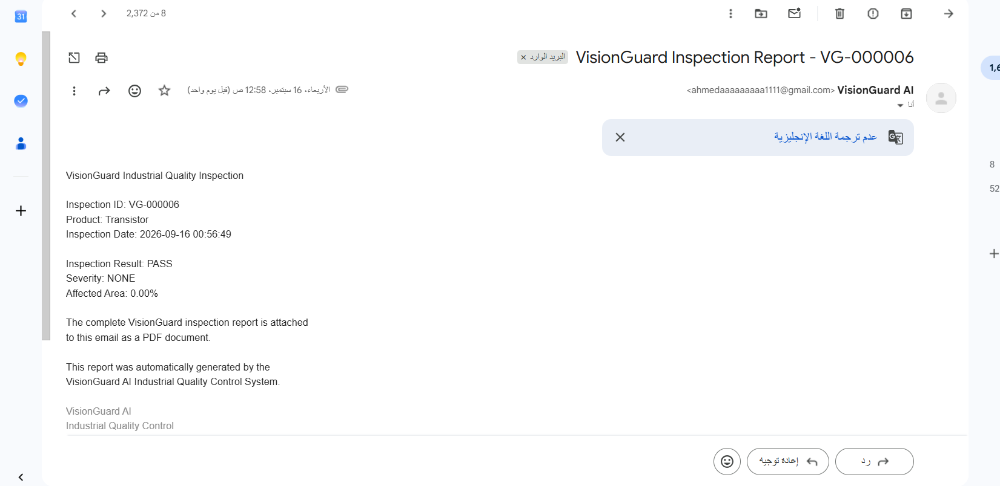
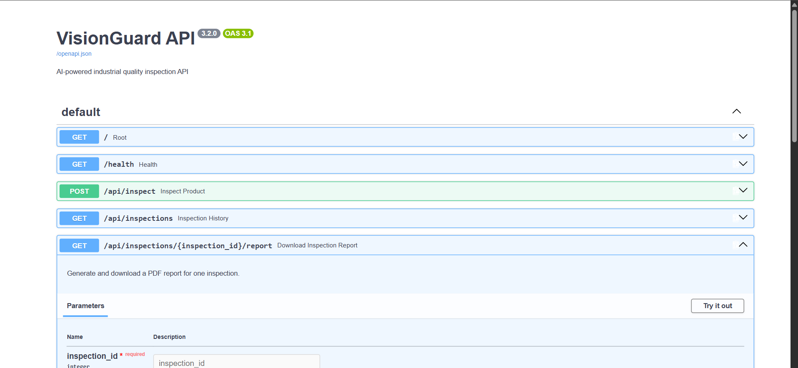

# VisionGuard AI

AI-powered industrial quality inspection: product classification, defect segmentation, ROI analysis, severity estimation, and automated PASS/REJECT decisions.

## Overview

VisionGuard is an end-to-end computer vision system that automates product quality inspection through a web application. For each uploaded image, it:

1. Verifies that the product matches the selected category.
2. Detects and segments defects at pixel level.
3. Calculates the affected area within a product-specific inspection region.
4. Estimates severity and issues a PASS or REJECT decision.
5. Stores the result and provides history, analytics, PDF reports, and email delivery.

## Pipeline

```
Product Image
      │
      ▼
Product Classification (15 categories)
      │
      ▼
Category Validation ── mismatch ──► Stop inspection
      │ match
      ▼
Defect Segmentation (YOLOv8s-seg)
      │
      ▼
Inspection ROI Generation
      │
      ▼
Affected Area (%) → Severity → PASS / REJECT
      │
      ▼
Database → Dashboard / History → PDF / Email Report
```

## Screenshots

| Dashboard | New Inspection |
| --- | --- |
|  |  |

| Inspection Result | Inspection History |
| --- | --- |
|  |  |

| Reports | PDF Report |
| --- | --- |
|  |  |

| Email Report | API (Swagger) |
| --- | --- |
|  |  |

## Features

**Product verification.** The uploaded image is classified before defect detection. If the prediction does not match the selected category, the inspection is stopped.

**Defect segmentation.** YOLOv8s-seg segments defects using a single class (`defect`). Instance segmentation provides a separate mask, bounding box, and confidence score for each defect.

**Inspection ROI.** Defect coverage is measured against a product-specific region rather than the whole image:

```
Affected Area (%) = (Defect Pixels Inside ROI / ROI Pixels) × 100
```

**Severity and decision.** The default threshold is 5% and is configurable.

| Condition | Severity | Decision |
| --- | --- | --- |
| No defect detected | NONE | PASS |
| Defect, affected area < 5% | MINOR | REJECT |
| Defect, affected area ≥ 5% | SEVERE | REJECT |

**Storage and reporting.** Inspections are saved in SQLite and used for history, dashboard statistics, and reports. PDF reports are generated with ReportLab and can be emailed through Gmail SMTP. Credentials are read from environment variables.

## Models

### Product Classification

- Architecture: YOLO11s-cls (15 classes)
- Evaluated on 817 held-out MVTec test images

| Metric | Result |
| --- | --- |
| Accuracy | 100% |
| Macro Precision | 100% |
| Macro Recall | 100% |
| Macro F1 | 100% |

The product categories are visually distinct. These results should not be taken as guaranteed performance on arbitrary real-world images.

### Defect Segmentation

- Architecture: YOLOv8s-seg (1 class: `defect`)
- Training: base run followed by fine-tuning with lighting and image augmentation
- Confidence threshold: 0.090, calibrated on the validation set

Image-level quality-control performance (validation):

| Metric | Result |
| --- | --- |
| Accuracy | 95.50% |
| Precision | 95.74% |
| Recall | 95.24% |
| Specificity | 95.77% |
| F1 Score | 95.49% |

Segmentation metrics (validation):

| Metric | Box | Mask |
| --- | --- | --- |
| Precision | 0.838 | 0.846 |
| Recall | 0.711 | 0.717 |
| mAP@50 | 0.765 | 0.788 |
| mAP@50-95 | 0.488 | 0.436 |

### ROI Coverage Validation

The affected-area calculation was compared against MVTec ground-truth masks.

| Metric | Result |
| --- | --- |
| Mean Absolute Error | 0.864 percentage points |
| Median Absolute Error | 0.282 percentage points |
| RMSE | 1.895 percentage points |
| Correlation | 0.9952 |
| Error ≤ 1 percentage point | 82.32% |
| Error ≤ 5 percentage points | 94.48% |

The correlation measures agreement between predicted and ground-truth coverage. It is not a classification accuracy.

## Dataset

The project uses the [MVTec Anomaly Detection (MVTec AD)](https://www.mvtec.com/company/research/datasets/mvtec-ad) dataset, covering all 15 product categories: bottle, cable, capsule, carpet, grid, hazelnut, leather, metal nut, pill, screw, tile, toothbrush, transistor, wood, and zipper.

MVTec AD is designed for unsupervised anomaly detection. VisionGuard repurposes its defect images and masks into a supervised segmentation workflow, so its segmentation results should not be directly compared with standard MVTec AD benchmarks.

Segmentation dataset: 2,516 images (1,258 defective, 1,258 good), split into 1,760 train, 378 validation, and 378 test images. Ground-truth masks were converted to YOLO segmentation polygons.

### ROI Strategies

| Strategy | Categories |
| --- | --- |
| Full surface | Carpet, Grid, Leather, Tile, Wood, Zipper |
| Foreground extraction | Bottle, Capsule, Hazelnut, Metal Nut, Pill, Toothbrush |
| Specialized logic | Cable, Screw, Transistor |

## Technology Stack

- **Frontend:** React, Vite, JavaScript, Lucide React
- **Backend:** Python, FastAPI, Ultralytics, OpenCV, NumPy, SQLite, ReportLab

## API Endpoints

| Method | Endpoint | Description |
| --- | --- | --- |
| POST | `/api/inspect` | Run a new inspection |
| GET | `/api/inspections` | List saved inspections |
| GET | `/api/inspections/{inspection_id}` | Retrieve one inspection |
| GET | `/api/dashboard` | Retrieve dashboard statistics |
| GET | `/api/inspections/{inspection_id}/report` | Download a PDF report |
| POST | `/api/inspections/{inspection_id}/email` | Email a PDF report |

Interactive documentation is available at `/docs` when the backend is running.

## Project Structure

```
VisionGuard-AI/
├── assets/images/          # README screenshots
├── backend/
│   ├── model/              # Model weights and model_config.json
│   ├── database.py
│   ├── detector.py
│   ├── email_service.py
│   ├── inspection_logic.py
│   ├── main.py
│   ├── product_classifier.py
│   ├── report_generator.py
│   ├── requirements.txt
│   └── .env.example
├── frontend/
│   ├── src/
│   ├── .env.example
│   ├── package.json
│   └── vite.config.js
└── notebooks/
    ├── VisionGuard_Training.ipynb
    └── VisionGuard_Run_on_Kaggle.ipynb
```

## Getting Started

### Backend

```bash
git clone https://github.com/JanaKandil/VisionGuard-AI.git
cd VisionGuard-AI/backend

python -m venv venv
# Windows:      venv\Scripts\activate
# macOS/Linux:  source venv/bin/activate

pip install -r requirements.txt
uvicorn main:app --reload
```

The API runs at `http://127.0.0.1:8000`. Optionally, copy `.env.example` to `.env` to configure CORS origins or SMTP email delivery.

### Frontend

```bash
cd frontend
npm install
npm run dev
```

The application runs at `http://localhost:5173`. By default it connects to `http://127.0.0.1:8000`. To use a different API address, copy `frontend/.env.example` to `frontend/.env` and set `VITE_API_URL`.

## Training

The full training pipeline is in `notebooks/VisionGuard_Training.ipynb` and is designed for Kaggle (GPU enabled, Internet on). It:

1. Builds the supervised segmentation dataset (70/15/15 split).
2. Trains the segmentation model (base run and augmentation fine-tune).
3. Calibrates the confidence threshold on the validation set and evaluates once on the test set.
4. Trains and evaluates the product classifier.
5. Exports `defect_segmentation.pt`, `product_classifier.pt`, and `model_config.json`.

Copy the exported files into `backend/model/` and restart the API. To run the full application on Kaggle, use `notebooks/VisionGuard_Run_on_Kaggle.ipynb`.

## Limitations

VisionGuard is a research prototype and has not been validated outside the MVTec AD domain.

- Changes in camera position, lighting, background, or product appearance may reduce performance.
- ROI quality varies between product categories.
- The 5% severity threshold is project-defined and must be calibrated to real manufacturing requirements before any production use.

## Future Work

- Further model and ROI optimization
- Validation on real industrial data
- Production deployment optimization

## License

The source code license has not yet been specified. The MVTec AD dataset is not included in this repository and is distributed under its own terms (commonly CC BY-NC-SA 4.0). Review and comply with the dataset license before using it, particularly for commercial purposes.

## Authors

- Ahmed Rahim ([@AhmedRahim01](https://github.com/AhmedRahim01))
- Jana Kandil ([@JanaKandil](https://github.com/JanaKandil))
